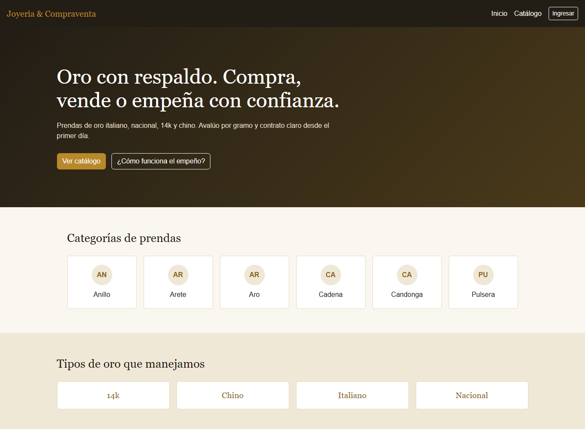
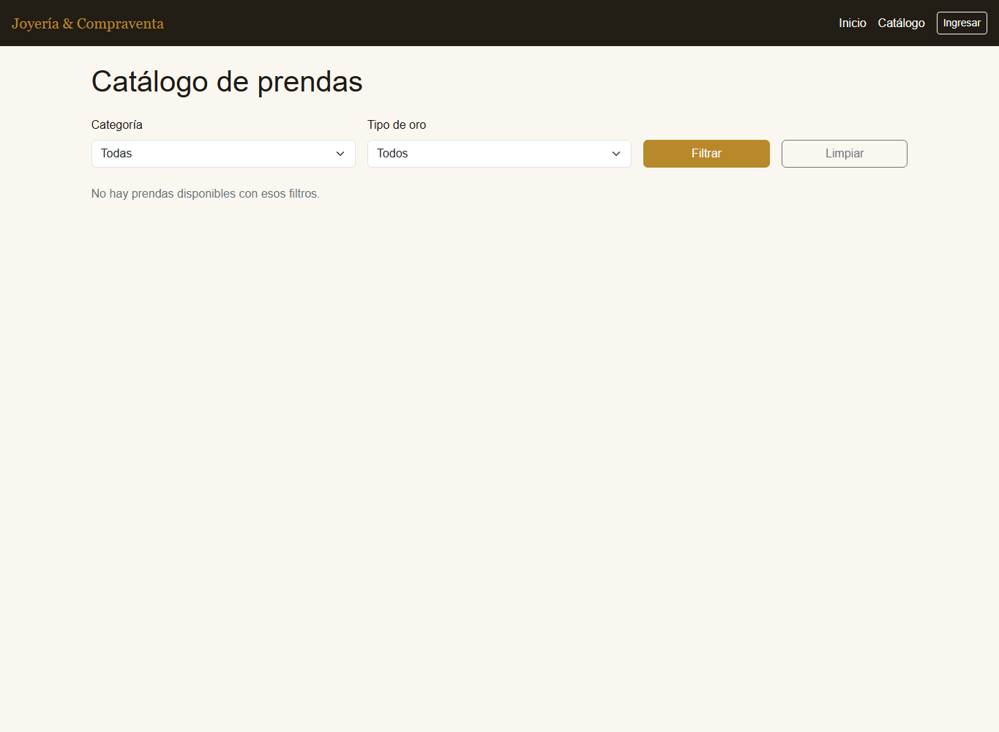

# Joyería y Compraventa

Aplicación web académica de gestión de inventario, ventas y empeños, construida
con Django y plantillas renderizadas en el servidor.

## Reglas de negocio acordadas

Respuestas del usuario recopiladas durante la Fase 2 e implementadas en los
servicios de empeños.

### Intereses y préstamos

- El rango de interés se selecciona según el monto prestado.
- La tasa del rango es mensual y el interés es simple.
- La tasa se conserva durante los primeros cuatro meses del contrato.
- El interés se calcula sobre el capital pendiente por cada período mensual.
- El plazo inicial es de cuatro meses calendario.
- Al calcular un pago, renovación o retiro, se cuenta el tiempo transcurrido
  hasta ese día. Para la fracción del mes: de 1 a 15 días cuenta medio mes; de
  16 días hasta el fin del mes cuenta un mes completo. Los intereses se
  redondean hacia arriba al peso.
- Después del vencimiento, la tasa aumenta 0,5 puntos porcentuales por cada
  mes de mora, incluidos períodos de medio mes según la regla anterior. La
  tasa aumentada se aplica al tiempo total del ciclo. Ejemplo confirmado: con
  tasa base de 5%, plazo inicial de cuatro meses y seis meses transcurridos
  desde el inicio (dos meses después del vencimiento), la tasa es 6% y el
  interés se calcula como capital × 6% × 6 meses.
- El valor máximo prestable se calcula según el peso y el tipo de oro:
  Italiano $300.000/g, Nacional $280.000/g, 14k $250.000/g y Chino
  $200.000/g. Se suman los valores de todos los artículos y el total se
  redondea una sola vez hacia abajo al millar. El préstamo mínimo es de
  $50.000 y el cliente puede solicitar menos que el máximo calculado.

### Abonos, renovaciones y liquidación

- Un abono se aplica primero a los intereses acumulados y el excedente reduce
  el capital.
- Se permite renovar en cualquier momento, incluso durante el período de
  gracia. El cliente paga el interés acumulado hasta la fecha de renovación.
- Al renovar, el nuevo cálculo de intereses empieza desde la fecha de la
  renovación para no volver a cobrar el interés ya pagado. La fecha de
  vencimiento se extiende cuatro meses calendario desde el vencimiento
  anterior.
- El cliente puede pagar el saldo total y retirar sus prendas en cualquier
  momento mientras el contrato siga ACTIVO, antes o después del vencimiento e
  incluso durante la gracia. El retiro cierra el contrato; si el administrador
  ya lo liquidó y pasó las prendas al inventario, el retiro ya no está
  disponible.
- Hay tres meses calendario de gracia después del vencimiento. Durante ese
  tiempo el cliente todavía puede renovar o retirar la prenda. La liquidación
  administrativa para pasarla a inventario se permite una vez cumplidos los
  tres meses.

### Asuntos pendientes

- No se proporcionaron criterios legales confirmados sobre topes de tasas,
  regulación aplicable a compraventas ni protección de datos. Se debe consultar
  al docente o al dueño del negocio antes de presentar el sistema como
  conforme a dichas normas. Este proyecto no constituye validación legal.
- Los montos y tasas específicos de cada rango de interés son datos
  configurables; los valores ficticios del comando DEMO no son reglas reales.

## Estado de construcción

- Fase 1: base Django, modelos iniciales, roles y datos DEMO.
- Fase 2: reglas de negocio documentadas arriba.
- Fase 3: servicios de cálculo y creación de contratos, clientes y flujo de
  contratos con artículos, detalle e impresión.
- Fase 4: abonos, renovaciones, retiros, anulación y paso de prendas al
  inventario después de los tres meses calendario de gracia.
- Fase 5: catálogo público con filtros, administración de prendas y ventas
  transaccionales que descuentan el inventario.
- Fase 6: Home integrado desde la maqueta, reportes básicos, páginas de error
  y pulido visual.
- Tarifas públicas: cotización XAU/COP, cálculo por pureza, margen de compra
  del 95% y comando para actualizar los precios.

## Instalación y ejecución

Requisitos: Python 3.12 o superior, pip y acceso a Internet para Bootstrap por
CDN.

```powershell
python -m venv venv
venv\Scripts\activate
pip install -r requirements.txt
python manage.py migrate
python manage.py crear_roles
python manage.py cargar_datos_demo
python manage.py runserver
```

`cargar_datos_demo` solo funciona con `DEBUG` activo. Crea usuarios DEMO con
la contraseña compartida `contraseña_demo1` y datos ficticios de clientes, contratos,
inventario y ventas. Las cuentas de cliente pueden ingresar en `/cuentas/login/`
y consultar sus propios contratos en `/mi-cuenta/`; no pueden entrar al panel
del personal ni realizar pagos en línea.

El comando muestra la contraseña cuando crea una cuenta. Para restablecer y
mostrar la contraseña de todas las cuentas DEMO, ejecuta:

```powershell
python manage.py cargar_datos_demo --reset-demo-passwords
```

Usa esa contraseña solo para las pruebas locales; no utilices estas cuentas ni
sus datos ficticios en producción.

Establece `DJANGO_SECRET_KEY` para entornos que no sean de desarrollo y usa
`DJANGO_DEBUG=False` en esos entornos.

Para validar la instalación y las pruebas:

```powershell
python manage.py check
python manage.py makemigrations --check --dry-run
python manage.py test
```

El panel de reportes de Administrador permite consultar contratos vigentes y
vencidos, y las ventas entre dos fechas. El catálogo público solo muestra
prendas disponibles.

## Catálogo de venta

El catálogo y el registro de ventas solo ofrecen prendas Italianas y
Nacionales. La tarifa es $350.000/g para Italiano y $330.000/g para Nacional;
el precio total de cada prenda se calcula multiplicando la tarifa por su peso.
En el catálogo se muestra la categoría como nombre de la prenda y, en la
descripción, su peso y tipo de oro. Los valores de compra de oro y las tarifas
para empeños son independientes de estos precios de venta.

## Simulador público de empeño

En `/empenos/simulador/`, cualquier visitante puede ingresar hasta cinco
artículos (categoría, tipo de oro y peso) y el valor que necesita. El simulador
calcula el valor prestable con las tarifas por tipo, muestra el máximo
disponible redondeado hacia abajo al millar y permite ingresar un préstamo
menor. También presenta las condiciones, el vencimiento y el interés/saldo
estimado mes a mes, incluida la mora durante el periodo de gracia. No solicita
datos personales ni crea ni guarda contratos.

## Tarifas públicas de compra del oro

La página de inicio muestra la tarifa estimada de compra por gramo para cada
tipo de oro. La cotización XAU/COP de GoldAPI.io se multiplica por la pureza configurada
para obtener el valor referencial. La tarifa pública de compra es el 95% de
ese valor; no se aplica ajuste por categoría. La tarifa es referencial; la
oferta final depende del peso y la pureza verificados en el local. Estas
tarifas de mercado no se usan para calcular el valor prestable de un empeño.

Purezas iniciales: Italiano 75%, Nacional 65%, 14k 58,3% y Chino 50%. Configura
un token de GoldAPI.io en la variable de entorno `GOLDAPI_TOKEN` y ejecuta:

```powershell
$env:GOLDAPI_TOKEN = "tu-token"
python manage.py actualizar_precios_oro
```

El comando guarda el precio internacional y la hora informada por la API,
actualiza las tarifas de compra de cada tipo y registra sus cambios en el historial.
Para mantener la página actualizada, programa el comando periódicamente con el
Programador de tareas de Windows según el intervalo y los límites de tu plan de
API. Si la consulta falla, conserva los últimos valores y reporta el error; la
página no presenta valores DEMO como tarifas vigentes.

Estas tarifas de compra basadas en el mercado son independientes de las
tarifas fijas usadas para calcular el máximo prestable en un empeño.

## Capturas

Inicio:



Catálogo público (sin prendas disponibles en la base de datos de captura):




